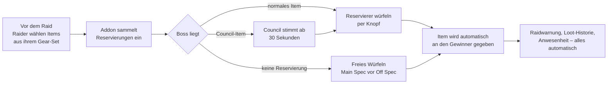

# Light Council

**Lootverteilung für World of Warcraft Forever – Reservierungen, Gear-Sets und Council-Entscheidungen in einem Addon.**

Kein Link zu einer Webseite, keine Tabelle, keine BiS-Liste, die jemand pflegen muss. Raider wählen ihre Items im Spiel, das Addon sammelt alles ein, der Council entscheidet mit allen Infos auf einen Blick, und am Ende landet jedes Item automatisch in der Historie.

> Interface 16001 · Deutsch, English, Français, Español, Русский · Version siehe [CHANGELOG](CHANGELOG.md)

*English summary: Light Council handles soft reservations, personal gear sets with priorities and council voting entirely in-game. No external website, no spreadsheet and no best-in-slot list to maintain – which matters in Forever, where different biomes favour different items. Switch the language with `/lc lang en`.*

---

## Inhalt

- [Warum Light Council?](#warum-light-council)
- [So läuft ein Raid ab](#so-läuft-ein-raid-ab)
- [Funktionen](#funktionen)
- [Gear-Sets statt BiS-Listen](#gear-sets-statt-bis-listen)
- [Vergleich mit anderen Systemen](#vergleich-mit-anderen-systemen)
- [Wie viel Arbeit man spart](#wie-viel-arbeit-man-spart)
- [Wer macht was?](#wer-macht-was)
- [Installation und Einrichtung](#installation-und-einrichtung)
- [Befehle](#befehle)
- [Sicherheit und Fairness](#sicherheit-und-fairness)
- [Häufige Fragen](#häufige-fragen)

---

## Warum Light Council?

Lootverteilung kostet in den meisten Gilden mehr Zeit als nötig: Reservierungs-Links posten, CSV-Dateien kopieren, BiS-Listen für jede Klasse pflegen, im Voice über Items diskutieren und hinterher eine Tabelle nachtragen. Light Council macht all das im Spiel – und das meiste davon automatisch.

| Ohne Light Council | Mit Light Council |
|---|---|
| Reservierungen über eine Webseite, Link posten, Liste importieren | Raider reservieren im Addon, der Council bekommt alles automatisch |
| Offiziere pflegen BiS-Listen pro Klasse, Spec und Biom | Jeder Raider pflegt **sein eigenes** Gear-Set mit eigener Prio |
| Council diskutiert im Voice, wer was bekommt | Kurze anonyme Abstimmung mit Score, Anwesenheit, Set-Prio und letztem Item |
| Loot-Historie und Anwesenheit per Hand in einer Tabelle | Beides wird automatisch erfasst und zwischen allen abgeglichen |
| Raider ohne Überblick, wer was reserviert hat | Item-Tooltips zeigen Reservierer, Prio und Sets – überall im Spiel |

---

## So läuft ein Raid ab

1. **Vor dem Raid:** Am Raidtag erinnert das Addon beim Einloggen alle, die noch nicht reserviert haben. Mit einem Klick werden die wichtigsten Items aus dem eigenen Gear-Set übernommen.
2. **Im Raid:** Der Plündermeister öffnet die Leiche. Für jedes Item weiß das Addon, wer es reserviert hat, und startet Würfelrunde oder Abstimmung.
3. **Danach:** Der Gewinner bekommt das Item direkt, alle sehen es per Raidwarnung, und es steht bei allen in der Loot-Historie.

---

## Funktionen

### Für alle Raider
- **Reservieren im Addon** – bis zu 1–5 Items pro Raid (stellt der Council ein). Einmal gespeichert ist die Wahl gesperrt; Änderungen gehen per Antrag mit Begründung an den Council.
- **Gear-Sets** – beliebig viele benannte Sets (z. B. eines pro Biom), Items in eigener Prio-Reihenfolge. Das Addon erkennt selbst, was du schon hast (angelegt, Taschen, Bank).
- **Loot-Fenster mit Würfel-Knopf** – Main Spec und Off Spec per Klick, alle sehen die Würfe live.
- **Raidtag-Erinnerung** – an euren Raidtagen ein Hinweis beim Einloggen, falls noch nichts reserviert ist.
- **Item-Tooltips** – über jedem Item: Council-Item, Prio, Reservierer und wer es im Set hat.
- **Loot-Historie** – wer hat wann welches Item bekommen, exportierbar für Tabelle oder Discord.

### Für den Council
- **Anonyme Abstimmung** bei wichtigen Items: *Freigeben*, *Eingrenzen* oder *Aussetzen* – mit Mehrheit aus 3 oder 5 Stimmen.
- **Alle Infos in einem Fenster:** Score (Anwesenheit, Parse, Engagement), Platz des Items im Gear-Set des Spielers, letztes erhaltenes Item, Loot-Cooldown.
- **Protokoll** jeder Entscheidung mit Stimmen und Begründung – nachvollziehbar, falls jemand fragt.
- **Änderungsanträge** von Raidern annehmen oder ablehnen, Reservierungen für Spieler ohne Addon eintragen.

### Für die Raidleitung
- **Automatische Vergabe** an den Gewinner, sobald das Lootfenster offen ist.
- **Anwesenheit** wird bei jedem Boss-Kill erfasst und zwischen allen Council-Mitgliedern abgeglichen.
- **`/lc check`** zeigt vor dem Pull, wer das Addon in welcher Version hat.
- **Test-Abstimmung** zum Ausprobieren, ohne dass etwas in den Raidchat geht.

---

## Gear-Sets statt BiS-Listen

In World of Warcraft Forever gibt es **das eine Best-in-Slot nicht mehr**. Je nach Biom sind andere Items stark – was in der Wüste das beste ist, ist es im Sumpf vielleicht nicht. Eine zentrale BiS-Liste wäre deshalb entweder falsch oder müsste für jede Klasse, jede Spec und jedes Biom einzeln gepflegt werden.

Light Council dreht das um: **Nicht die Gildenleitung pflegt Listen für alle, sondern jeder Raider pflegt sein eigenes Set.**

| | Klassische BiS-Liste | Light Council Gear-Set |
|---|---|---|
| Wer pflegt sie? | Offiziere, für alle Klassen und Specs | Jeder Raider für sich selbst |
| Biome / Situationen | Pro Biom eine eigene Liste nötig | Beliebig viele Sets, eins ist aktiv |
| Was hat der Spieler schon? | Muss er selbst eintragen oder melden | Erkennt das Addon automatisch |
| Prio des Spielers | Meist nicht erfasst | Eigene Reihenfolge, 1 = am wichtigsten |
| Sichtbar für den Council | Separate Tabelle oder Webseite | Direkt im Abstimmungsfenster („#1 von 6“) |
| Nach einem Patch | Listen neu recherchieren | Raider passt sein Set in Minuten an |

**Was der Council dadurch sieht:** Steht ein Item bei Spieler A auf Platz 1 seiner fehlenden Items und bei Spieler B auf Platz 8, ist die Entscheidung schnell getroffen – ohne Diskussion, ohne Nachfragen.

**Und Randoms?** Wer kein Set hat, reserviert einfach wie gewohnt. Ob Raider direkt aus ihrem Set reservieren dürfen, schaltet der Council ein oder aus. Die Reservierungsplätze sind für alle gleich.

---

## Vergleich mit anderen Systemen

| | Reservierungs-Webseite + `/roll` | Council-Addon ohne Reservierungen | BiS- / Wunschlisten-Webseite | **Light Council** |
|---|:---:|:---:|:---:|:---:|
| Reservieren ohne Webseite | – | – | – | ✅ |
| Reservierung gesperrt, Änderung per Antrag | teils | – | – | ✅ |
| Council-Abstimmung im Spiel | – | ✅ | – | ✅ |
| Persönliche Prio pro Spieler | – | – | ✅ | ✅ |
| Erkennt automatisch, was man schon hat | – | teils | – | ✅ |
| Funktioniert ohne BiS-Daten | ✅ | ✅ | – | ✅ |
| Würfeln per Knopf, Main/Off Spec | – | – | – | ✅ |
| Automatische Vergabe an den Gewinner | – | teils | – | ✅ |
| Loot-Historie und Anwesenheit automatisch | – | teils | teils | ✅ |
| Raider ohne Addon können mitmachen | ✅ | ✅ | ✅ | ✅ (über `/roll` und Raidchat) |

*„teils“ heißt: je nach Werkzeug und Einrichtung vorhanden. Light Council ist speziell für WoW Forever gebaut (Vor- und Nachnamen, Biome, Interface 16001).*

---

## Wie viel Arbeit man spart

**Beispielrechnung** für eine Gilde mit 25 Raidern, einem Raid pro Woche und drei Biomen. Die Minuten sind Schätzungen aus dem typischen Ablauf – eure Zahlen können abweichen.

### Einmalig: BiS-Listen entfallen

| Aufgabe | Klassisch | Mit Light Council |
|---|---|---|
| BiS-Listen anlegen (≈ 9 Klassen × 2 Specs × 3 Biome = 54 Listen à 20 Min.) | **≈ 18 Stunden** Offiziersarbeit | **0** – jeder Raider legt sein Set selbst an (≈ 5 Min. pro Person) |
| Listen nach einem Patch aktualisieren | ≈ 3–5 Stunden | Jeder passt sein eigenes Set an |

### Pro Raid

| Aufgabe | Klassisch | Mit Light Council |
|---|---|---|
| Reservierungen einsammeln (Link posten, nachhaken, importieren) | ≈ 15 Min. | **0** – kommt automatisch, Erinnerung am Raidtag |
| Council-Items besprechen (≈ 8 Items à 2–3 Min. im Voice) | ≈ 20 Min. | ≈ 5 Min. – Abstimmung mit allen Infos im Fenster |
| Loot-Historie nachtragen | ≈ 10 Min. | **0** – automatisch |
| Anwesenheit nachhalten | ≈ 10 Min. | **0** – bei jedem Boss-Kill automatisch |
| **Summe pro Raid** | **≈ 55 Minuten** | **≈ 5 Minuten** |

**Pro Monat (4 Raids): ≈ 3 Stunden 20 Minuten weniger Verwaltung – plus die ≈ 18 Stunden für BiS-Listen, die gar nicht erst anfallen.** Und der Raid selbst läuft schneller, weil zwischen den Bossen niemand auf eine Entscheidung wartet.

---

## Wer macht was?

| Rolle | Einmalig | Pro Raid |
|---|---|---|
| **Raider** | Addon installieren, Gear-Set anlegen | Am Raidtag reservieren (ein Klick aus dem Set), im Raid per Knopf würfeln |
| **Council** (3 oder 5) | Namen eintragen | Bei Council-Items abstimmen (≈ 30 Sek. pro Item) |
| **Raidleitung / Plündermeister** | Council festlegen, Council-Items markieren, Raidtage einstellen | Plündermeister-Modus an, Leichen öffnen – den Rest macht das Addon |

---

## Installation und Einrichtung

1. Den Ordner `LightCouncil` nach `World of Warcraft\_forever_\Interface\AddOns\` kopieren.
2. Spiel starten oder `/reload`.
3. **Raidleitung:** `/lc` öffnen → **Erste Schritte** führt durch alles:
   - Council-Mitglieder unter **Einstellungen** eintragen (Vor- und Nachname),
   - unter **Raid-Loot** die wichtigen Items als Council-Items markieren,
   - unter **Reservierungen → Raidtage** die Raidtage setzen und optional „Reservieren aus dem Gear-Set“ einschalten.
4. **Raider:** `/lc` → **Gear-Sets** anlegen, dann unter **Meine Reservierung** reservieren.

Optional als Loot-Quelle: **AtlasLoot** (Classic/Forever) oder **Naowh Forever**. Ohne Loot-Quelle funktioniert alles per Shift-Klick oder Item-ID.

---

## Befehle

| Befehl | Wirkung |
|---|---|
| `/lc` | Hauptfenster öffnen |
| `/lc loot` | Loot-Fenster für Raider öffnen/schließen |
| `/lc test [Itemlink]` | Council-Ablauf allein testen (nichts geht in den Raidchat) |
| `/lc check` | Wer im Raid hat das Addon in welcher Version? |
| `/lc lang <auto\|de\|en\|fr\|es\|ru>` | Sprache wechseln |
| `/lc tooltip` | Infos im Item-Tooltip ein-/ausschalten |
| `/lc anw` | Anwesenheit jetzt erfassen |
| `/lc log` | Letzte Entscheidungen im Chat |
| `/lc abbruch` | Laufende Abstimmung/Würfelrunde abbrechen |
| `/lc councilreset` | Gespeicherte Council-Liste vergessen und neu anfragen |
| `/lc hilfe` | Alle Befehle |

---

## Sicherheit und Fairness

- **Nur die richtige Stelle zählt:** Reservierungen, Loot-Historie und Anwesenheit übernimmt das Addon nur vom Council; Abstimmungen und Loot-Fenster nur vom Raidleiter oder Plündermeister. Niemand kann mit einem Skript fremde Daten fälschen oder Reservierungen löschen.
- **Anonyme Abstimmung:** Raider sehen das Ergebnis und die Begründung, aber nicht, wer wie gestimmt hat.
- **Bewertungen bleiben vertraulich:** Parse und Engagement gehen nur per Flüstern an Council und Raidleitung.
- **Nachvollziehbar:** Jede Entscheidung steht mit Stimmen und Begründung im Protokoll.
- **Immer aktuell bleiben:** `/lc check` zeigt veraltete Versionen im Raid.

---

## Häufige Fragen

**Müssen alle das Addon haben?**
Nein. Ohne Addon wird ganz normal mit `/roll` im Raidchat gewürfelt, und der Council kann Reservierungen für diese Spieler eintragen. Mit Addon geht es aber deutlich schneller.

**Muss ich ein Gear-Set anlegen?**
Nein. Das Set ist eine Hilfe für dich und eine Info für den Council. Reservieren geht auch ohne Set.

**Zählt meine Set-Prio automatisch beim Würfeln?**
Nein. Wer würfeln darf, bestimmen die Reservierungen und bei Council-Items die Abstimmung. Die Set-Prio sieht der Council als Entscheidungshilfe.

**Was ist mit verschiedenen Biomen?**
Leg einfach ein Set pro Biom an und schalte das aktive Set um. Der Council sieht immer das aktive.

**Welche Sprachen gibt es?**
Deutsch, Englisch, Französisch, Spanisch und Russisch – standardmäßig die Sprache deines Spielclients, umschaltbar in den Einstellungen.

---

## Entwicklung

- Alle sichtbaren Texte stehen im Code auf Deutsch als `L["…"]`; Übersetzungen in `Locales/*.lua`. `perl tools/check_locales.pl` meldet fehlende oder fehlerhafte Übersetzungen.
- Die Versionsnummer steht nur in `LightCouncil.toc`.
- Änderungen: siehe [CHANGELOG.md](CHANGELOG.md).

## Lizenz

Die Schrift Inter steht unter der SIL Open Font License 1.1 (`Media/Fonts/FONT-LICENSE.txt`).
