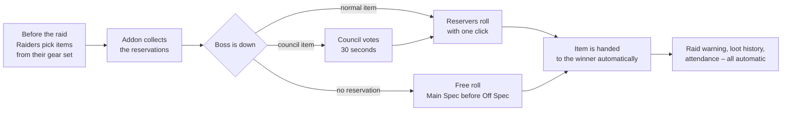

# Light Council

**Loot distribution for World of Warcraft Forever – reservations, gear sets and council decisions in one addon.**

No link to a website, no spreadsheet, no best-in-slot list that someone has to maintain. Raiders pick their items in-game, the addon collects everything, the council decides with all the information at a glance, and every item ends up in the loot history automatically.

> Interface 16001 · English, Deutsch, Français, Español, Русский · Version: see the [CHANGELOG](CHANGELOG.md)

---

## Contents

- [Why Light Council?](#why-light-council)
- [How a raid works](#how-a-raid-works)
- [Features](#features)
- [Gear sets instead of BiS lists](#gear-sets-instead-of-bis-lists)
- [Comparison with other systems](#comparison-with-other-systems)
- [How much work it saves](#how-much-work-it-saves)
- [Who does what?](#who-does-what)
- [Installation and setup](#installation-and-setup)
- [Commands](#commands)
- [JSON export](#json-export)
- [Security and fairness](#security-and-fairness)
- [FAQ](#faq)

---

## Why Light Council?

In most guilds, loot distribution takes more time than it needs to: posting reservation links, copying CSV files, maintaining BiS lists for every class, discussing items in voice chat and updating a spreadsheet afterwards. Light Council does all of that in-game – and most of it automatically.

| Without Light Council | With Light Council |
|---|---|
| Reservations via a website, post the link, import the list | Raiders reserve in the addon, the council receives everything automatically |
| Officers maintain BiS lists per class, spec and biome | Every raider maintains **their own** gear set and marks what matters most |
| The council discusses in voice chat who gets what | A short anonymous vote with score, attendance, gear set and last item |
| Loot history and attendance kept by hand in a spreadsheet | Both are recorded automatically and synced between everyone |
| Raiders have no overview of who reserved what | Item tooltips show reservers and sets – everywhere in the game |

---

## How a raid works

1. **Before the raid:** On raid day, the addon reminds everyone who hasn't reserved yet when they log in. One click takes the most important items from their own gear set.
2. **In the raid:** The master looter opens the corpse. For every item the addon knows who reserved it and starts a roll or a council vote.
3. **Afterwards:** The winner gets the item directly, everyone sees it via raid warning, and it shows up in everyone's loot history.

---

## Features

### For all raiders
- **Reserve in the addon** – 1 to 5 items per raid (set by the council). Once saved, the choice is locked; changes go to the council as a request with a reason.
- **Gear sets** – any number of named sets (e.g. one per biome), laid out by slot like the character window: one item per slot (two rings, two trinkets), important items marked with a star, plus an optional **upgrade** per slot – a second choice that is not the best, but better than what you wear now. Reserve straight from the set: each item has a “Reserve” tick for the raid it drops in. Pick items with a tick from a raid → boss → item overview. The addon detects what you already have (equipped, bags, bank).
- **Item search** – type part of a name or an item ID and pick the item from the list. The search covers every raid in the loot source and jumps straight to the right raid and boss – no more clicking through bosses.
- **Loot window with a roll button** – Main Spec and Off Spec with one click, everyone sees the rolls live.
- **Raid day reminder** – a notice at login on your raid days if you haven't reserved yet.
- **Item tooltips** – on every item: council item, reservers and who has it in their set.
- **Loot history** – who got which item and when, exportable for a spreadsheet or Discord.

### For the council
- **Anonymous voting** on important items: *Release*, *Restrict* or *Sit out* – majority of 3 or 5 votes.
- **Everything in one window:** score (attendance, parse, engagement), whether the item is in the player's gear set (“★ important”, “in set”, “upgrade”, “has it”), what they currently wear in that slot (with item level), last item received, loot cooldown.
- **Log** of every decision with votes and reasons – traceable if anyone asks.
- **Change requests** from raiders can be approved or declined; reservations can be entered for players without the addon – or they whisper a council member `!lc [item]` and are entered automatically.

### For the raid lead
- **Automatic awarding** to the winner while the loot window is open.
- **Attendance** is recorded on every boss kill and synced between all council members.
- **`/lc check`** shows before the pull who has the addon and which version.
- **Test vote** to try everything out without anything going to raid chat.

---

## Gear sets instead of BiS lists

In World of Warcraft Forever there is **no single best-in-slot anymore**. Depending on the biome, different items are strong – what's best in the desert may not be in the swamp. A central BiS list would therefore either be wrong or would have to be maintained separately for every class, every spec and every biome.

Light Council turns this around: **the guild leadership doesn't maintain lists for everyone – every raider maintains their own set.**

| | Classic BiS list | Light Council gear set |
|---|---|---|
| Who maintains it? | Officers, for all classes and specs | Each raider for themselves |
| Biomes / situations | One separate list per biome needed | Any number of sets, one is active |
| What does the player already have? | They have to enter or report it | Detected automatically by the addon |
| What matters most to the player | Usually not recorded | Marked with a star per item |
| Visible to the council | Separate spreadsheet or website | Right in the vote window (“★ important”, “in set”, “upgrade”, “has it”) |
| After a patch | Research the lists again | The raider adjusts their set in minutes |

**What the council sees:** If player A still needs the item and marked it as important, while player B has it in the set but not marked, the decision is made quickly – no discussion, no follow-up questions.

**And pugs?** Anyone without a set simply reserves as usual. Every raider can tick “Reserve” right in their set; the council only decides whether the “Take from gear set” button is offered. The number of reservation slots is the same for everyone.

---

## Comparison with other systems

| | Reservation website + `/roll` | Council addon without reservations | BiS / wishlist website | **Light Council** |
|---|:---:|:---:|:---:|:---:|
| Reserve without a website | – | – | – | ✅ |
| Reservation locked, changes by request | partly | – | – | ✅ |
| Council voting in-game | – | ✅ | – | ✅ |
| Personal wishes per player (gear set, important marks) | – | – | ✅ | ✅ |
| Detects automatically what you already have | – | partly | – | ✅ |
| Works without BiS data | ✅ | ✅ | – | ✅ |
| Roll button, Main/Off Spec | – | – | – | ✅ |
| Automatic awarding to the winner | – | partly | – | ✅ |
| Loot history and attendance automatic | – | partly | partly | ✅ |
| Raiders without the addon can take part | ✅ | ✅ | ✅ | ✅ (via `/roll` and raid chat) |

*“partly” means: available depending on the tool and its setup. Light Council is built specifically for WoW Forever (first and last names, biomes, interface 16001).*

---

## How much work it saves

**Example calculation** for a guild with 25 raiders, one raid per week and three biomes. The minutes are estimates based on the typical workflow – your numbers may differ.

### One-time: no more BiS lists

| Task | Classic | With Light Council |
|---|---|---|
| Create BiS lists (≈ 9 classes × 2 specs × 3 biomes = 54 lists at 20 min each) | **≈ 18 hours** of officer work | **0** – every raider creates their own set (≈ 5 min per person) |
| Update the lists after a patch | ≈ 3–5 hours | Everyone adjusts their own set |

### Per raid

| Task | Classic | With Light Council |
|---|---|---|
| Collect reservations (post link, chase people, import) | ≈ 15 min | **0** – arrives automatically, reminder on raid day |
| Discuss council items (≈ 8 items at 2–3 min in voice) | ≈ 20 min | ≈ 5 min – vote with all info in one window |
| Update the loot history | ≈ 10 min | **0** – automatic |
| Track attendance | ≈ 10 min | **0** – automatic on every boss kill |
| **Total per raid** | **≈ 55 minutes** | **≈ 5 minutes** |

**Per month (4 raids): ≈ 3 hours 20 minutes less admin – plus the ≈ 18 hours for BiS lists that never come up.** And the raid itself runs faster, because nobody waits for a decision between bosses.

---

## Who does what?

| Role | Once | Per raid |
|---|---|---|
| **Raider** | Install the addon, create a gear set | Reserve on raid day (one click from the set), roll with a button in the raid |
| **Council** (3 or 5) | Enter the names | Vote on council items (≈ 30 s per item) |
| **Raid lead / master looter** | Set the council, mark council items, set raid days | Turn on master loot, open corpses – the addon does the rest |

---

## Installation and setup

1. Copy the `LightCouncil` folder to `World of Warcraft\_forever_\Interface\AddOns\`.
2. Start the game or type `/reload`.
3. **Raid lead:** open `/lc` → **Getting started** walks you through everything:
   - enter the council members under **Settings** (first and last name),
   - mark the important items as council items under **Gear sets → Items** or **My reservation** (tick “Council”),
   - set the raid days under **Reservations → Raid days** and optionally turn on “Offer reserving from gear sets”.
4. **Raiders:** `/lc` → create a set under **Gear sets** and reserve right there (tick “Reserve”) or under **My reservation**.

Optional loot sources: **AtlasLoot** (Classic/Forever) or **Naowh Forever**. Without a loot source everything works via shift-click or item ID.

The language follows your game client; switch it with `/lc lang en` (or `de`, `fr`, `es`, `ru`) or under **Settings**.

---

## Commands

| Command | Effect |
|---|---|
| `/lc` | Open the main window |
| `/lc loot` | Open/close the loot window for raiders |
| `/lc test [itemlink]` | Test the council flow on your own (nothing goes to raid chat) |
| `/lc check` | Who in the raid has the addon, and which version? |
| `/lc lang <auto\|de\|en\|fr\|es\|ru>` | Change the language |
| `/lc tooltip` | Turn item tooltip info on/off |
| `/lc json` | Export all data as JSON (for a website or your own analysis) |
| `/lc json auto` | Turn the JSON file on logout on/off |
| `/lc anw` | Record attendance now |
| `/lc log` | Recent decisions in chat |
| `/lc abbruch` | Cancel the running vote or roll |
| `/lc councilreset` | Forget the stored council list and request it again |
| `/lc help` | All commands |

**Whisper commands for players without the addon** (whisper a council member; turn off under *Settings → Options*):

| Whisper | What it does |
|---|---|
| `!lc [item] [item]` | Reserve the items for the raid they drop in (same limit as in the addon) |
| `!lc - [item]` | Remove items from your reservation |
| `!lc` | Show your reservations and the commands |

If the reservation is already locked, the whisper becomes a change request; the player gets a whisper when the council decides. Commands and replies are hidden from the council member's chat.

---

## JSON export

WoW addons cannot connect to the internet, so Light Council writes its data to a file instead. Everything can be exported as JSON, ready for a guild website, a Discord bot or your own spreadsheet:

- **In-game:** `/lc json` or *Loot history → Export → JSON (all data)* – the text is selected, Ctrl+C copies it.
- **As a file:** on logout or `/reload` the addon writes the same JSON to
  `WTF\Account\<account>\SavedVariables\LightCouncil.lua` as `LightCouncilExport.json`. An upload tool can pick it up from there. Turn it off with `/lc json auto`.

Contents (`schema: 1`, times as Unix timestamps): `history`, `historyDeleted`, `attendance`, `sitouts`, `players` (wins), `councilItems`, `reserves`, `gearSets`, `council`, `settings` and the decision `log`. Since the council syncs among itself, one council member's export is enough.

Parse, engagement and the log are only included when a council member exports; votes never contain voter names.

**For website developers:** names, set names, raid names and reasons are typed in by players. Always escape them (HTML) before displaying them, and only accept uploads from people you trust.

---

## Security and fairness

- **Only the right source counts:** the addon accepts reservations, loot history and attendance only from the council, and votes and the loot window only from the raid leader or master looter. Nobody can fake other people's data or delete reservations with a script.
- **Anonymous voting:** raiders see the result and the reason, but not who voted how.
- **Ratings stay confidential:** parse and engagement are only whispered to the council and the raid lead.
- **Honest gear sets:** if the loot history shows that a player received an item, it counts as owned – nobody can look needier than they are.
- **Traceable:** every decision is in the log with votes and reasons.
- **Stay up to date:** `/lc check` shows outdated versions in the raid.

---

## FAQ

**Does everyone need the addon?**
No. Without the addon, players roll as usual with `/roll` in raid chat. They reserve by whispering a council member `!lc [item]`, or the council enters reservations for them. With the addon it is a lot faster, though.

**Do I have to create a gear set?**
No. The set helps you and informs the council. You can reserve without a set.

**Can I use my gear set and normal reservations at the same time?**
Yes. Your gear set holds one item per slot (with important ones marked) and the council sees it. Your reservation (e.g. 3 items per raid) decides what you roll for. “Take from gear set” only pre-fills your reservation – you can mix set items and other items freely. A set does not give you extra reservation slots.

**Does my gear set count automatically when rolling?**
No. Who may roll is decided by reservations and, for council items, by the vote. The council sees your set and the important marks as decision support.

**What about different biomes?**
Just create one set per biome and switch the active set. The council always sees the active one.

**Which languages are available?**
English, German, French, Spanish and Russian – by default your game client's language, switchable in the settings.

---

## Development

- All visible texts are written in German in the code as `L["…"]`; translations live in `Locales/*.lua`. `perl tools/check_locales.pl` reports missing or broken translations.
- The version number lives only in `LightCouncil.toc`.
- Changes: see [CHANGELOG.md](CHANGELOG.md).

## License

The Inter font is licensed under the SIL Open Font License 1.1 (`Media/Fonts/FONT-LICENSE.txt`).
